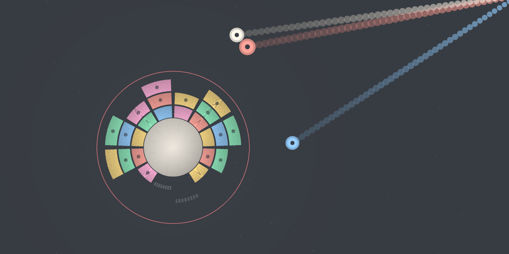

# Accretion

A tiny planet sits at the center of the screen. Debris of many colors curve
toward it. **You spin the planet** to choose where each piece crashes — and a
full ring explodes, dropping everything above it toward the core, which can
trigger longer and longer chains.

Spin. Catch. Close rings. Don't cross the red line.

## Play

Open `index.html` — the game is a single self-contained file
(HTML + Canvas 2D + Web Audio, no dependencies, no network calls, works
offline). Less than 5 MiB total.

## Rules

- The planet has **12 sectors** and up to **8 layers**. Each debris lands in
  the sector it touches, on the **lowest free layer** of that sector.
- A **complete ring** (12/12 sectors occupied at the same layer) **explodes**.
  Every column then collapses under gravity, which can complete other rings:
  the **cascade**. The 2nd ring of a chain scores ×2, the 3rd ×3…
- A ring of a **single color** is a *pure ring*: ×3 and a light wave.
- **Debris types** (as levels rise): *simple* · *bar* (two adjacent sectors) ·
  *comet* (destroys the block it hits instead of landing) · *unstable core*
  (lands, then shatters the neighboring blocks on its own layer — the gaps it
  leaves are cascade fuel: save them for last).
- The game ends when a debris must land **beyond the 8th layer** (the red
  line). Layers 7–8 occupied? The line pulses and a quiet alarm rises.
- **Fairness first**: a live marker on the surface shows exactly where each
  incoming debris will land, and it moves as you spin. A red "!" marker means
  the landing would cross the red line.

## Controls

| | Spin the planet | Pull nearest debris |
|---|---|---|
| Keyboard | ← → or A / D | ↓, S or Space |
| Touch | drag anywhere | quick tap |
| Gamepad-likes | left stick feel | A |

- **P / Esc**: pause (automatic when the tab loses focus).
- A short tutorial is woven into the first 30 seconds of your first game.
- `?debug=1` shows FPS, current spawn interval and level. Nothing else.

## Scoring

- Ring: **100 × layer** (outer rings are riskier, and worth more).
- Chain: each extra ring multiplies by ×2, ×3, ×4…
- Pure ring: ×3.
- Pulling a debris: +5 (it lands sooner — a risk you choose).
- Best score and longest chain are saved locally (guarded `localStorage`).

## Accessibility & options

- Every color also carries a **pattern** (dot, stripe, triangle, ring, cross)
  for color-blind players.
- **Reduce motion** toggle (defaults to your OS preference): disables screen
  shake and slow-motion, calms pulses.
- **Sound** toggle — all sounds are synthesized with Web Audio (no files,
  audio starts only after your first input).
- Interface in **English (default), French, Spanish** — auto-detected from
  your browser, switchable any time.

## Development

- Everything lives in `index.html`. All tunable values are grouped in the
  `CFG` object at the top of the script.
- The pure game logic is delimited by `/*__CORE_START__*/ … /*__CORE_END__*/`
  markers so tests can extract and exercise it headlessly (grid rules, ring
  detection, cascade resolution, scoring, difficulty curve, i18n, plus a
  player simulation with a shared-rotation model and 50 000-move fuzz).
- Produced by Z Code (GLM) for Cédric Bernadac's game workshop, October 31,
  2026. All graphics and sounds are original and generated in code.

## License

MIT — see [LICENSE](LICENSE). Cover generated by the included tooling; no
third-party assets.
